# TB Guard

**Skrining TB dari suara batuk di ruang publik: sensor, AI, dan dashboard dalam satu platform.**

Sensor mic array menangkap batuk di stasiun, terminal, atau ruang tunggu faskes. AI memberi skor risiko, kamera dan arah suara menunjuk sumbernya, lalu petugas kesehatan menindaklanjuti lewat dashboard, pelacakan pasien, dan agen AI yang bisa diajak bicara.

[Buka aplikasi](https://tb-guard-web-103365519692.us-central1.run.app) &middot; [Dokumentasi pipeline ML](docs/ML_PIPELINE.md) &middot; [Notebook pelatihan (Colab)](TB_Guard_CWT_Training_Colab.ipynb)

> **Catatan ilmiah.** TB Guard adalah prototipe riset. Hasil deteksi batuk **bukan** diagnosis tuberkulosis; skor akustik dipakai untuk memprioritaskan pemeriksaan bakteriologis (TCM GeneXpert). Angka pada halaman "Peluang Pasar" dan simulasi Orchestra bersifat ilustratif.

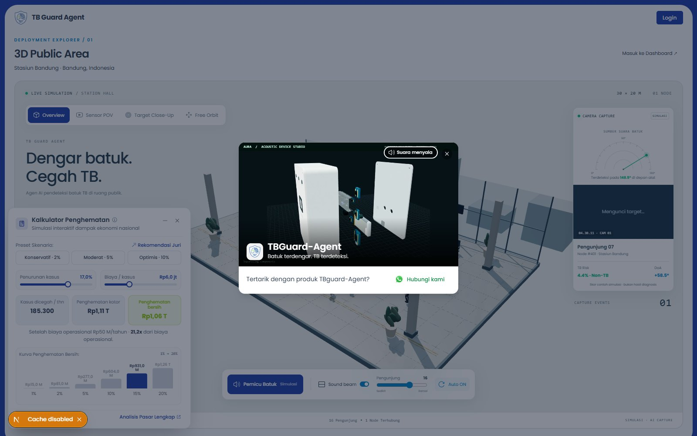

---

## Daftar isi

1. [Fitur](#fitur)
2. [Arsitektur](#arsitektur)
3. [Teknologi](#teknologi)
4. [Menjalankan secara lokal](#menjalankan-secara-lokal)
5. [Deploy ke Google Cloud](#deploy-ke-google-cloud)
6. [API ringkas](#api-ringkas)
7. [Keamanan](#keamanan)
8. [Struktur repositori](#struktur-repositori)
9. [Pipeline ML dan hasil model](#pipeline-ml-dan-hasil-model)
10. [Batasan](#batasan)

---

## Fitur

### Masuk dengan Gmail
Login hanya lewat Google Sign-In dan hanya akun `@gmail.com`; tidak ada username atau password. Backend memverifikasi ID token Google, lalu peran dan status akun dibaca dari database pada setiap permintaan.

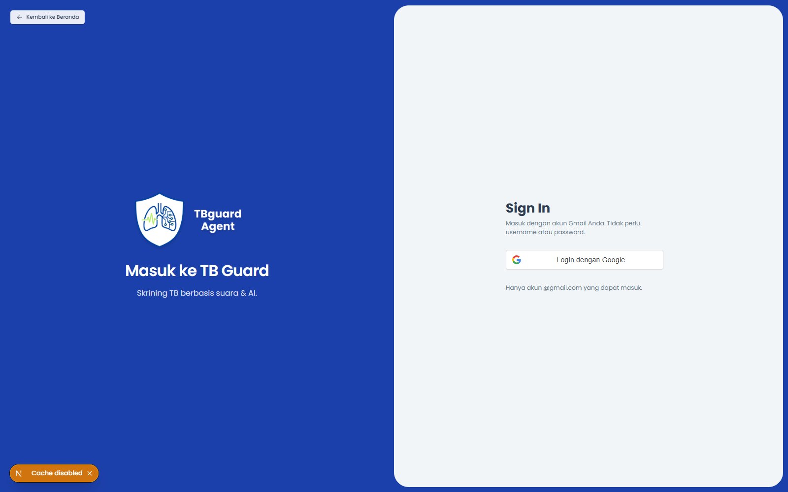

### 3D Public Area
Simulasi penempatan sensor di Stasiun Bandung: pengunjung bergerak, sensor menangkap batuk, kerucut arah suara (DOA) dan kartu tangkapan kamera menyorot orang yang batuk. Kamera bisa dipindah ke preset overview, sensor, atau target.

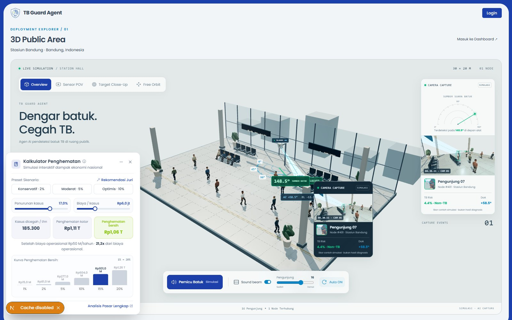

### Dashboard
Ringkasan deteksi, tren per jam, status perangkat, deteksi TB yang belum ditinjau, dan peta lokasi sensor. Semua data berasal dari PostgreSQL lewat backend Go.

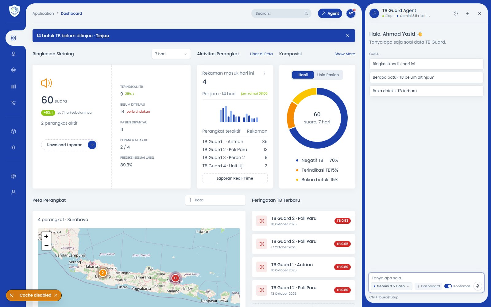

### Agen AI (chat, suara, dan kendali layar)
Agen memahami perintah bahasa sehari-hari dan menjalankan tool nyata: membaca data, menambah atau mengubah perangkat, deteksi, dan pasien, lalu menyimpannya ke database.

- **Kendali tampilan:** agen menggerakkan kamera 3D, memfilter tabel, membuka modal deteksi, dan mengganti tema. Pada tangkapan layar di bawah, agen memfilter Device List langsung di depan pengguna.
- **Aman:** aksi hapus meminta konfirmasi, tulis hanya untuk Admin, dan hasil baru dilaporkan berhasil bila server benar-benar menyimpan.
- **Suara:** teks muncul langsung saat berbicara, lalu dirapikan Whisper dengan kosakata TB Guard (mis. "tebe gard" menjadi "TB Guard").
- **Transparan:** setiap jawaban menampilkan waktu generate, jumlah token, model yang menjawab, dan badge spesialis yang bekerja.
- **Tangguh:** Gemini 3.x lewat Vertex AI (endpoint global) dengan rantai model cadangan, lalu Groq; tombol Diagnosa (Admin) memeriksa tiap model.

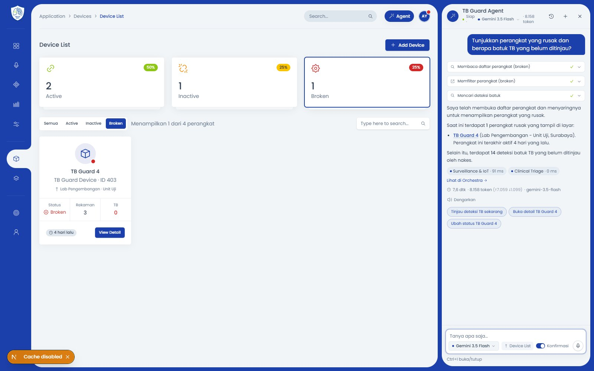

### Riwayat chat tersimpan di database
Setiap percakapan tersimpan per pengguna di PostgreSQL: cari, lanjutkan, ganti nama, sematkan, dan hapus.

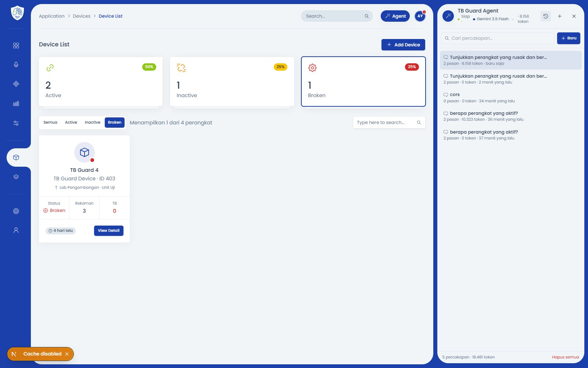

### Palet perintah (Ctrl+K)
Tanya agen atau lompat ke halaman mana pun tanpa membuka panel chat. Saran menyesuaikan halaman yang sedang dibuka.

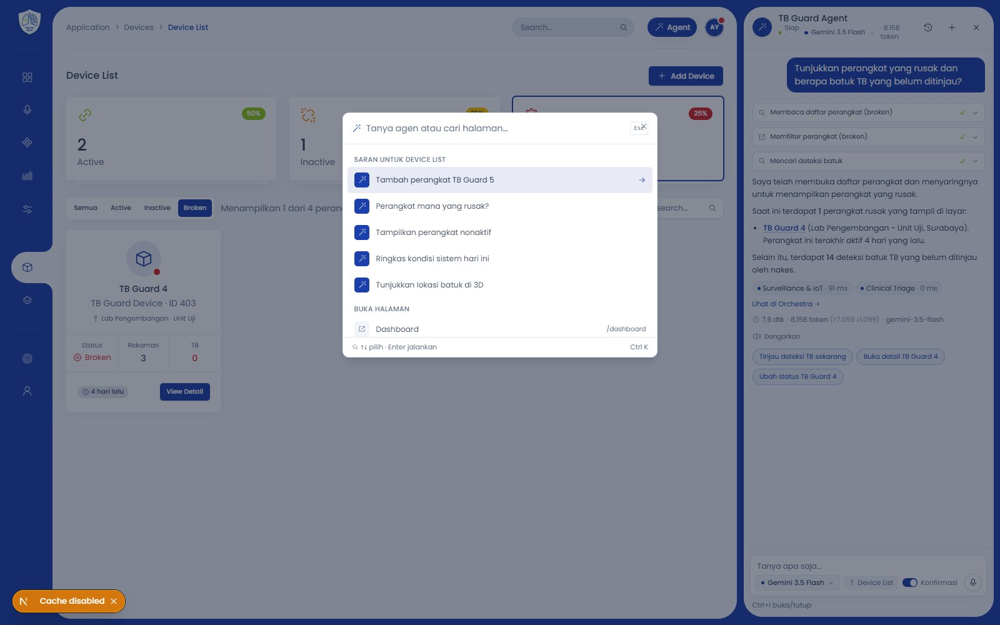

### Perangkat
Daftar sensor dengan status aktif, nonaktif, dan rusak, filter cepat, dan detail per perangkat.

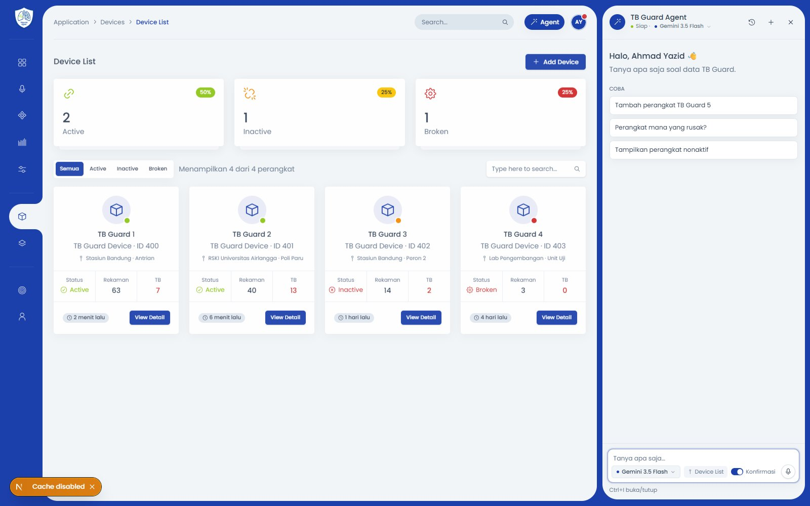

### Detail deteksi batuk
Skor model, arah suara (DOA), pelacakan kamera, serta pemutar rekaman dengan waveform dan spektrogram. Rekaman diambil dari Neon Object Storage.

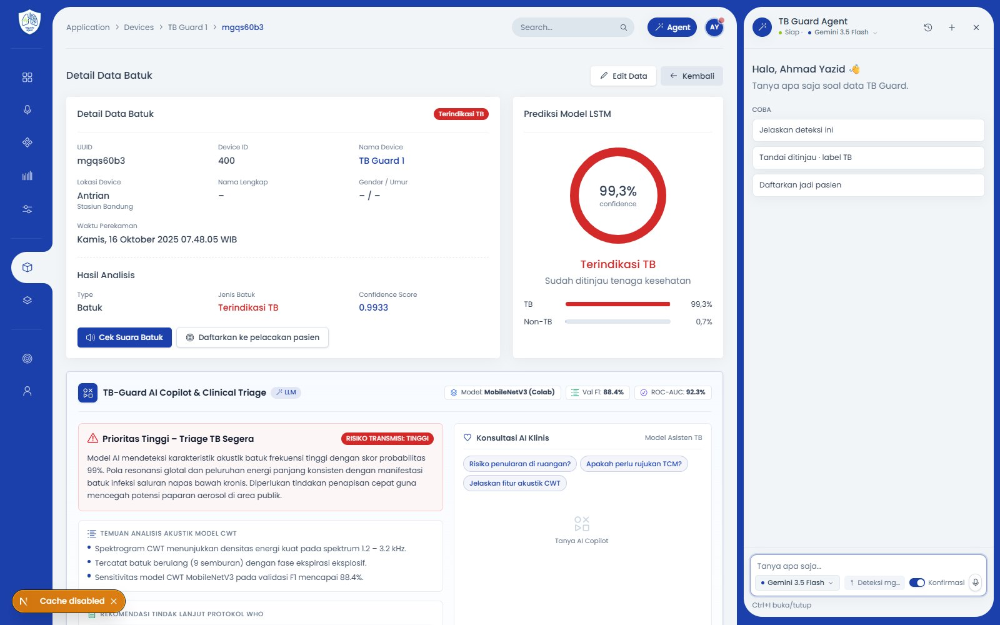

### Pelacakan pasien
Alur lima tahap dari terdeteksi sampai sembuh, lengkap dengan kepatuhan minum obat, PIC, dan jadwal kunjungan.

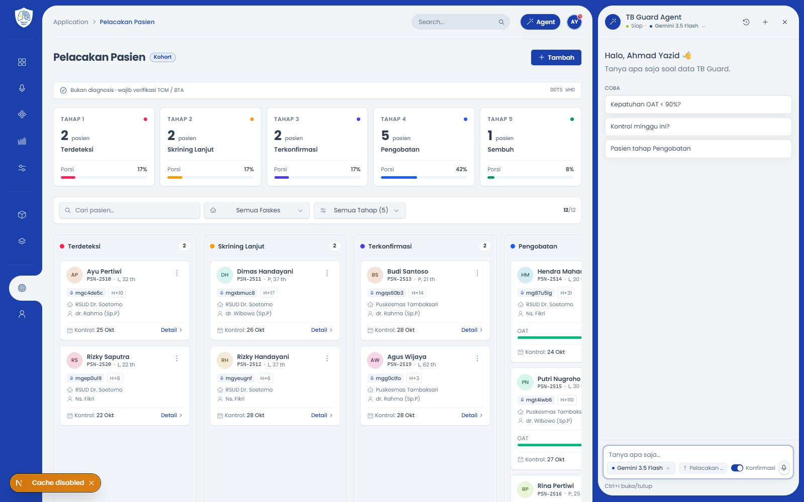

### Data batuk penelitian
Tiga dataset penelitian (web form, naracoba offline, data TB primer) dengan tabel, filter, dan ekspor CSV.

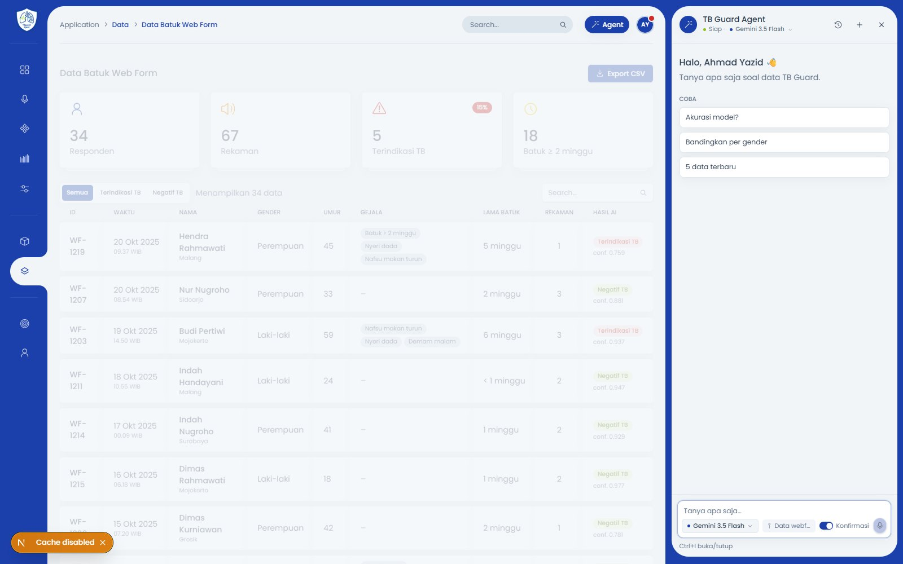

### 3D Prototype perangkat
Studio rekayasa perangkat: komponen, wiring, mode terpisah, dan animasi *separation and reassembly* dengan kamera yang berputar mulus.

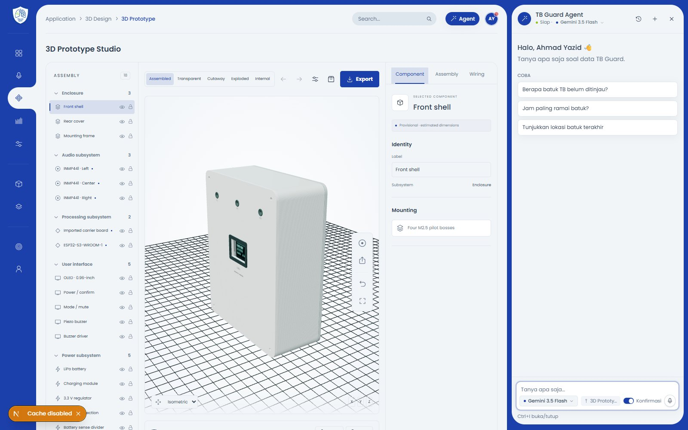

### Peluang Pasar
Kalkulator penghematan (penurunan kasus x biaya per kasus), perbandingan biaya TB biasa dan TB resisten obat, serta segmen pembeli. Semua asumsi dapat digeser dan disebutkan sumbernya.

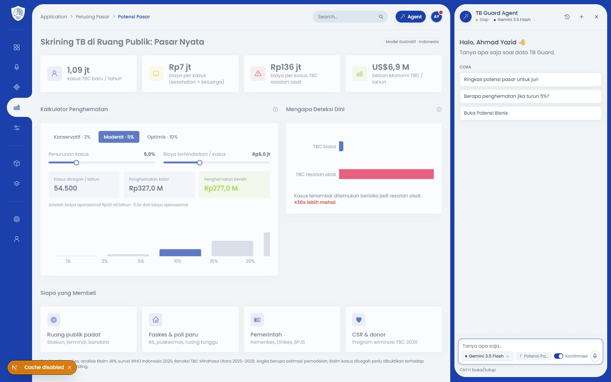

### Orchestra AI
Visualisasi cara kerja agen sebagai tim: **Master Orchestrator** membagi tugas ke empat spesialis (Sensor, Triase, Pendamping Pasien, Analisis Kebijakan). Kanvas tersambung **live** ke chat agen: kabel mengalirkan partikel, node spesialis berdenyut dengan nama tool yang dipanggil, dan live trace menampilkan latensi nyata. Tersedia juga tiga skenario simulasi terskrip untuk demo.

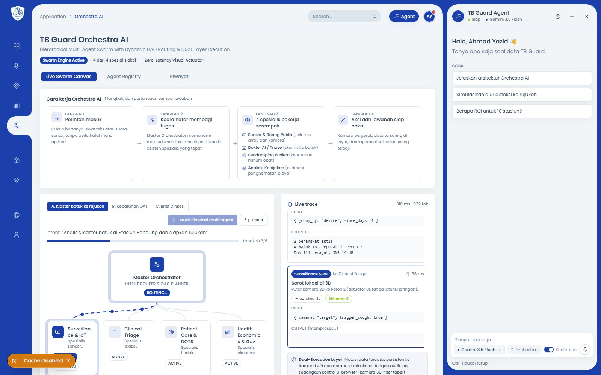

Sub-agen dapat diaktifkan atau dinonaktifkan, ditambah manual (persona dan akses tool) atau dibuat otomatis dari deskripsi kebutuhan.

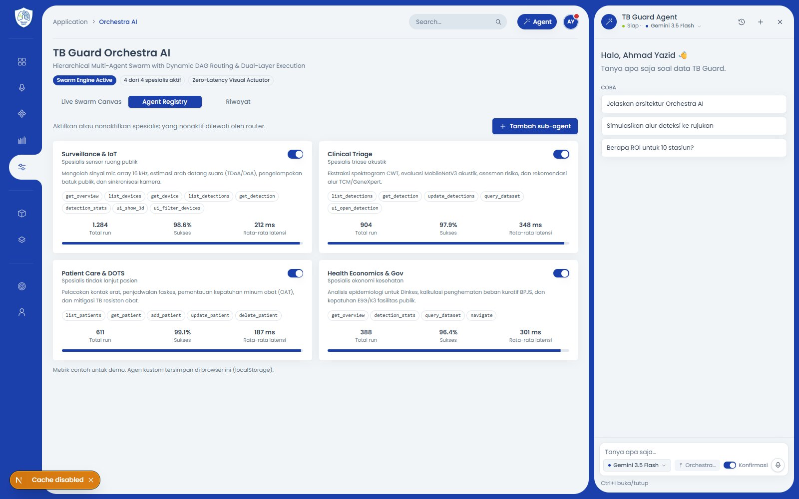

Setiap jalannya Orchestra, baik dari chat maupun simulasi, **tersimpan di database** dan dapat dibaca ulang seperti percakapan dengan bahasa sehari-hari.

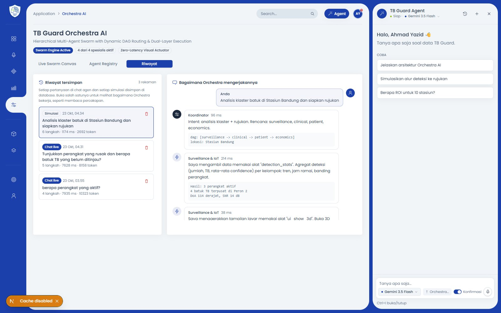

### Pengguna dan jejak aktivitas (Admin)
Akun Gmail tersimpan di database dengan peran Admin atau Petugas. Admin dapat mengubah peran, menonaktifkan, atau menghapus akun, dan melihat aktivitas terbaru. Perangkat, deteksi, dan pasien mencatat siapa yang membuat atau mengubahnya.

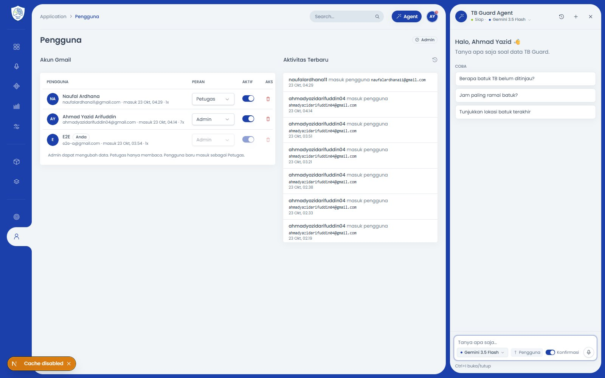

---

## Arsitektur

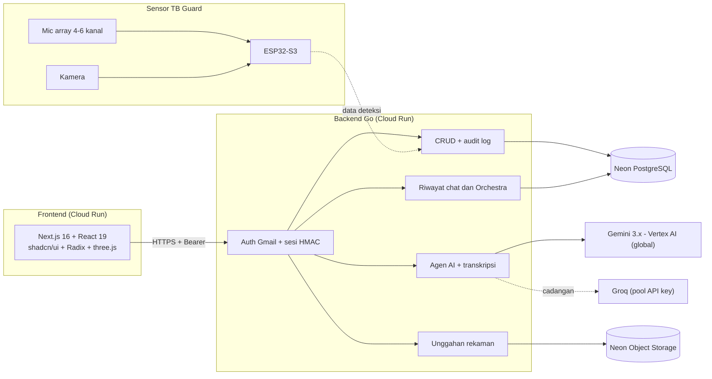

Prinsip desain:

- **Satu binary Go**, hanya stdlib dan pgx, image distroless sekitar 22 MB, cold start cepat di Cloud Run.
- **Dua lapis eksekusi agen:** mutasi data tersimpan persisten lewat backend (dengan audit log), sedangkan kendali UI (kamera 3D, filter tabel) berjalan instan di browser.
- **Gagal-aman:** database belum siap membalas 503 (tidak crash), model AI gagal berpindah ke model cadangan, peran tidak terbaca berarti hanya-baca.

## Teknologi

| Lapisan | Teknologi |
| :-- | :-- |
| Frontend | Next.js 16 (App Router), React 19, TypeScript, Tailwind CSS 4, shadcn/ui, Radix UI dan Radix Icons, recharts, three.js dan react-three-fiber, wavesurfer.js |
| Backend | Go 1.25, `net/http`, pgx v5, SigV4 buatan sendiri untuk S3 |
| Database | PostgreSQL (Neon, pooler) |
| Penyimpanan | Neon Object Storage (S3-compatible), dengan kuota ketat |
| AI | Gemini 3.x (Vertex AI, endpoint global), Groq (Qwen, GPT-OSS, Whisper) |
| Cloud | Google Cloud Run, Cloud Build, Artifact Registry, Secret Manager |
| ML | PyTorch, MobileNetV3-Small pada CWT scalogram, evaluasi dengan scikit-learn |

## Menjalankan secara lokal

Prasyarat: Node.js 20+, Go 1.25+, akun Neon (PostgreSQL), dan `gcloud auth login` bila ingin memakai Gemini lewat Vertex AI.

```bash
# 1. Backend
cd backend
cp .env.example .env          # isi DATABASE_URL, GOOGLE_CLIENT_ID, SESSION_SECRET, dll.
go run ./cmd/server           # http://localhost:8080 (skema dan data contoh dibuat otomatis)

# 2. Frontend
cd frontend
cp .env.example .env.local    # NEXT_PUBLIC_BACKEND_URL dan NEXT_PUBLIC_GOOGLE_CLIENT_ID
npm install
npm run dev                   # http://localhost:3100

# atau keduanya sekaligus
npm run dev:all
```

Backend tidak hot-reload: setelah mengubah kode Go, jalankan ulang perintahnya.

Variabel penting (`backend/.env.example` menjelaskan semuanya):

| Variabel | Fungsi |
| :-- | :-- |
| `DATABASE_URL` | Koneksi Neon PostgreSQL (pooler) |
| `GOOGLE_CLIENT_ID` | OAuth Web Client ID untuk login Gmail |
| `SESSION_SECRET` | Kunci penandatangan sesi (minimal 16 karakter) |
| `ADMIN_EMAILS` | Email yang selalu menjadi Admin |
| `GEMINI_MODEL` / `GEMINI_LOCATION` | Model Gemini (bawaan `gemini-3.5-flash`) dan lokasi (`global`) |
| `GROQ_API_KEYS` / `GROQ_KEYS_FILE` | Pool key Groq untuk cadangan LLM dan Whisper |
| `S3_*` dan `UPLOAD_*` | Neon Object Storage dan batas unggahan |

### Pengujian

```bash
cd backend && go test ./...                # unit + integrasi (butuh DATABASE_URL)
S3_LIVE=1 go test ./internal/storage/      # uji langsung ke object storage
cd frontend && npx tsc --noEmit && npm run build
```

## Deploy ke Google Cloud

```bash
# sekali: buat secret (DATABASE_URL, kunci S3, SESSION_SECRET, key Groq) dari backend/.env
PROJECT_ID=<project> bash backend/deploy/setup-secrets.sh

# build dan deploy backend + frontend ke Cloud Run
gcloud builds submit --config cloudbuild.yaml .
```

Detail IAM dan pembuatan OAuth Client ID ada di komentar `cloudbuild.yaml`. Skrip `backend/deploy/setup-cicd.sh` menyiapkan deploy otomatis saat push ke `main` (membutuhkan koneksi repo GitHub di Cloud Build).

## API ringkas

Semua endpoint selain `/health`, `/readyz`, dan `/api/auth/google` wajib `Authorization: Bearer <token>`. Aksi tulis pada data memerlukan peran Admin.

| Endpoint | Fungsi |
| :-- | :-- |
| `POST /api/auth/google` | Tukar ID token Google (`@gmail.com`) dengan sesi |
| `GET /api/bootstrap` | Seluruh data awal (gzip) |
| `POST/PATCH/DELETE /api/devices\|detections\|patients` | CRUD dengan atribusi pengguna dan audit log |
| `POST /api/agent` | Agen AI (stream NDJSON: konten, tool call, token, waktu) |
| `POST /api/agent/transcribe` | Suara ke teks bertingkat (Whisper turbo, large-v3, Gemini) |
| `GET /api/ai/diagnose` | Diagnosa model AI (Admin) |
| `GET/PUT/PATCH/DELETE /api/chats` | Riwayat chat per pengguna |
| `GET/PUT/DELETE /api/orchestra/runs` | Rekaman Orchestra per pengguna |
| `POST /api/uploads`, `GET /api/detections/{id}/audio` | Rekaman batuk di object storage |
| `GET/PATCH/DELETE /api/users`, `GET /api/activity` | Manajemen pengguna dan jejak aktivitas (Admin) |

## Keamanan

- Login Gmail-only; token Google diverifikasi (tanda tangan RS256, `iss`, `aud`, `exp`, `email_verified`).
- Peran dan status akun dibaca dari database setiap permintaan; akun nonaktif atau terhapus langsung ditolak.
- Chat dan rekaman Orchestra terikat ke pemiliknya; pengguna lain tidak bisa membaca atau menimpanya.
- Agen dan transkripsi dibatasi 40 permintaan per menit per pengguna; unggahan dibatasi ukuran, tipe, total, dan jumlah harian.
- Rahasia hanya di Secret Manager atau `backend/.env` (tidak di-commit); pesan error ke pengguna tidak membocorkan detail internal.
- Hasil tool dan data diperlakukan sebagai data, bukan instruksi (mitigasi prompt injection).

## Struktur repositori

```
backend/                Go API (cmd/server + internal/{auth,db,data,ai,chats,orchestra,storage,users,...})
frontend/               Next.js app (app/, views/, components/, lib/)
3dDesign/               Studio 3D perangkat (Vite) dan skrip render video iklan
src/tb_guard_ml/        Pipeline ML (audio, fitur, pelatihan, evaluasi, simulasi gateway)
docs/                   Dokumentasi, tangkapan layar, panduan dataset
cloudbuild.yaml         Build dan deploy Cloud Run
TB_Guard_CWT_Training_Colab.ipynb   Pelatihan model CWT satu klik
```

## Pipeline ML dan hasil model

Model **MobileNetV3-Small pada scalogram CWT** dilatih pada dataset batuk klinis (RespiScan, Coswara, COUGHVID) dan dievaluasi pada 420 sampel uji terpisah:

| Metrik | Hasil | Target WHO (TPP) |
| :-- | :--: | :--: |
| Akurasi | 93,10% | - |
| Sensitivitas (TB) | 92,63% | >= 90% |
| Spesifisitas | 93,48% | >= 70% |
| ROC-AUC | 0,9682 | >= 0,85 |

Detail eksperimen, asal dataset, dan cara mereproduksi ada di [docs/ML_PIPELINE.md](docs/ML_PIPELINE.md).

## Batasan

- Prototipe riset: belum divalidasi klinis dan bukan alat diagnosis.
- Skenario Orchestra di kanvas adalah simulasi terskrip; agen chat memanggil tool sungguhan.
- Analisis ROI memakai asumsi yang dapat digeser dan perlu dibuktikan lewat uji lapangan dengan kelompok pembanding.
- Deploy ke Cloud Run masih manual (`cloudbuild.yaml` siap dipakai setelah trigger dan IAM disiapkan).
